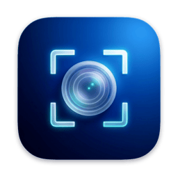

<div align="center">
  
  <h1>iSnip</h1>
  <p><strong>轻量、极速的原生 macOS 截图标注、智能无损压缩与离线 OCR 工具</strong></p>
  <p>
    <a href="https://github.com/zzusec/isnip/releases/latest"></a>
    
    
    
    <a href="LICENSE"></a>
  </p>
</div>

---

**iSnip** 基于纯原生 Swift（`AppKit` · `ScreenCaptureKit` · `CoreGraphics` · `Vision`）构建，不依赖 Electron 或 WebView 运行时，常驻菜单栏待机 **0% CPU**。开箱内置 `pngquant + oxipng` 双引擎压缩管线与端侧离线文字识别，兼顾像素级标注精度与零打扰操作体验。

## 功能亮点

- **零抖动瞬时抓屏与窗口吸附**
  - 按下全局热键（默认 `F1`）原亮度静默冻结当前画面，无全屏缩放抖动或变暗闪烁。
  - 光标悬停自动高亮独立桌面窗口（智能过滤最大化背景窗，避免误框选整屏），配备 `11×11` 光学像素放大镜、实时尺寸读数与 `#HEX` / `RGB` 取色（`C` / `⇧C`）。
- **内置 `pngquant + oxipng` 智能无损压缩（默认开启）**
  - 应用包内自带独立 `pngquant --speed 1` 与 `oxipng -o max --strip safe`，无需手工配置命令行环境。
  - 典型 `1.2 MB` Retina 高清截图可直降至约 `0.3~0.4 MB`（体积缩减 `60%~75%`），肉眼几乎无差异；支持切换 **视觉无损 / 均衡 (65–90) / 极限 (45–75)** 三档。
  - **复制与保存双链路生效**：按 `Enter` 复制到剪贴板或按 `⌘S` 保存本地时均采用「0ms 瞬时输出 + 后台原子精压」两阶段管线，不阻塞界面。
- **默认位置静默直存（免弹窗打扰）**
  - 点击工具栏保存（`↓`）或按 `⌘S` 默认直接保存到 `~/Downloads`（或自定义目录），同名文件自动递增编号防覆盖，不再每次弹出询问框；按 `⇧⌘S` 或按住 `⌥` 点击保存可随时触发「另存为…」。
- **16 项毛玻璃工具栏与 10 种矢量标注**
  - 精简悬浮主栏，二级线宽 / 字号 / 调色板与连续渐变 HSV 取色器按需展开；24 个工具栏槽位支持逐项显隐定制。
  - 内置 **矩形（可调圆角）、椭圆、直线、三次贝塞尔曲线箭头、平滑画笔、三次盒式高斯模糊、原生中文输入文本、自动递增序号、聚光灯、正片叠底荧光笔**，全部支持二次拖拽缩放与 100 步撤销重做。
- **滚动长截图（`S`）**
  - 框选视口后直接穿透滚动页面，基于行哈希重叠一致性校验与固定页眉 / 页脚自动剥离，支持上下双向拼接、实时缩略图预览与 `⌘Z` 分段回退。
- **置顶贴图（`F3`）**
  - 支持将截图或剪贴板内容置顶悬浮对比，支持滚轮中心缩放、`⌘`/`⌃` + 滚轮调节透明度、圆角发光边框开关、鼠标点击穿透及按 `Space` 原地补画标注。
- **端侧离线 Vision OCR 与二维码识别（`F2` / `T`）**
  - 支持直接框选识字、截图内识字、贴图按 `T` 识字、长截图整图提取及剪贴板 / 本地图片文件识别。
  - 支持多语种实时切换（自动 / 简中 / 繁中 / English / 日本語 / 한국어）、段落软换行智能合并及二维码链接一键打开，**全程本地离线推理，绝不上传云端**。

## 下载与安装

### 方式一：下载安装包（推荐）

1. 前往 **[GitHub Releases](https://github.com/zzusec/isnip/releases/latest)** 下载最新 `isnip-macos-arm64-v*.dmg`。
2. 打开 DMG，将 **iSnip.app** 拖入 `/Applications`。
3. 若首次打开提示未知开发者拦截，可在终端执行一次清除隔离属性：
   ```sh
   xattr -dr com.apple.quarantine /Applications/iSnip.app
   ```
4. 首次触发截图时，按提示在「系统设置 → 隐私与安全性 → 录屏与系统录音」中开启 **iSnip** 授权。

### 方式二：从源码编译安装

环境要求：**macOS 14.0+**、**Xcode Command Line Tools（Swift 5.10+）**。

```sh
git clone https://github.com/zzusec/isnip.git
cd isnip
sh scripts/install-local.sh --no-pull
```

## 默认快捷键速查

> 所有全局快捷键、截图内功能键及 10 项标注工具键均可在「设置 → 快捷键」中自由修改或清除。

| 场景 | 快捷键 | 功能说明 |
| :--- | :--- | :--- |
| **全局** | `F1` | 开始截图 |
| **全局** | `F2` | 直接框选截图 OCR 识字 |
| **全局** | `F3` / `⌃F3` | 从剪贴板置顶贴图 / 切换全部贴图边框 |
| **选区与输出** | `Enter` / 双击选区 | 复制截图到剪贴板并完成 |
| **选区与输出** | `⌘S` / `⇧⌘S` | 静默保存到默认目录 / 弹出「另存为…」 |
| **选区与输出** | `S` / `T` | 进入滚动长截图 / 识别选区文字（自动忽略标注层干扰） |
| **选区与取色** | `C` / `⇧C` | 复制光标处像素 `#HEX` / `RGB` 色值 |
| **选区与微调** | `⌥ + 方向键`（配 `⇧` 5px） | 像素级微调选区尺寸；`⇧F1` 重新抓屏 |
| **标注编辑** | `1` – `0` | 快速切换 10 种矢量标注工具 |
| **标注编辑** | `⌘Z` / `⇧⌘Z` / `Delete` | 撤销 / 重做 / 删除当前选中标注 |
| **置顶贴图** | `Space` / `T` / `Esc` | 原地补画标注 / 贴图识字 / 关闭当前贴图 |
| **置顶贴图** | `滚轮` / `⌘ + 滚轮` | 中心平滑缩放 / 调节贴图透明度 |

## 仓库目录结构

```text
isnip/
├── Package.swift          # SwiftPM 工程定义（AirSnipCore 核心库 + iSnip 可执行程序）
├── Info.plist             # 应用包元数据、版本号与权限说明
├── Assets/                # 应用图标资源（AppIcon.icns / icon.png）
├── Sources/
│   ├── AirSnipCore/       # 核心引擎：矢量标注模型与渲染、PNG/WebP 编解码与双引擎压缩、长截图拼接、离线 OCR
│   └── AirSnipApp/        # 原生界面：零抖动冻结覆盖层、毛玻璃工具栏、置顶贴图、OCR 结果窗、设置面板
├── Tests/
│   └── AirSnipCoreTests/  # 标注撤销、压缩管线、长截图拼接、OCR 排版与配置兼容性单元测试
├── Vendor/                # 应用内嵌独立压缩工具（pngquant / oxipng 及依赖动态库）
└── scripts/               # 打包签名、端到端冒烟测试、发布策略校验、本机安装与 Release 发布脚本
```

## 本地开发与验证

```sh
# 1. 构建 iSnip.app、校验签名与内置压缩引擎，并运行 7 项端到端冒烟自检
sh scripts/test-app-smoke.sh

# 2. 运行核心库单元测试与发布策略检查
swift test
python3 scripts/test-release-policy.py

# 3. 打包并安装到本机 /Applications/iSnip.app
sh scripts/install-local.sh --no-pull
```

## 隐私与开源许可

- **零联网采集**：截图、标注、图像压缩、OCR 文字与二维码识别均 100% 在本机离线完成（仅在启用「自动检查更新」时访问 GitHub Releases API 查询最新版本号）。
- **开源协议**：本项目源码遵循 [GPL-3.0-only](LICENSE) 许可证；应用包内嵌命令行工具遵循各自开源协议（`pngquant` GPL-3.0、`oxipng` MIT）。
